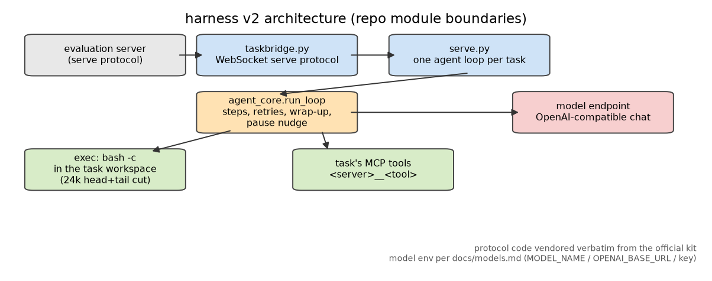
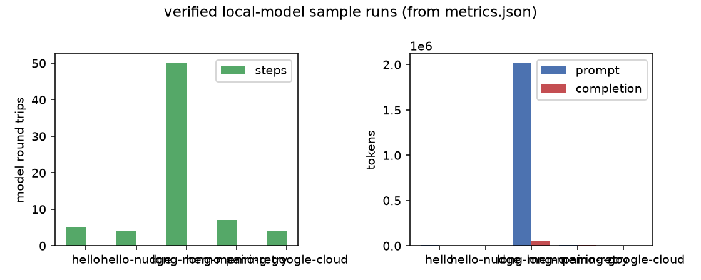
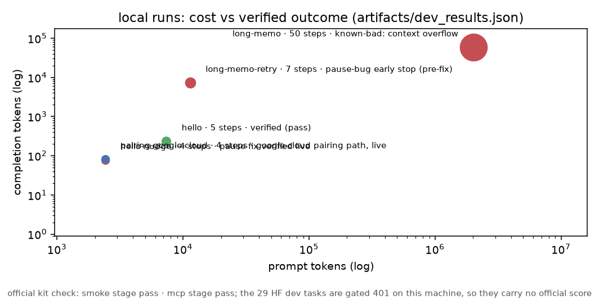
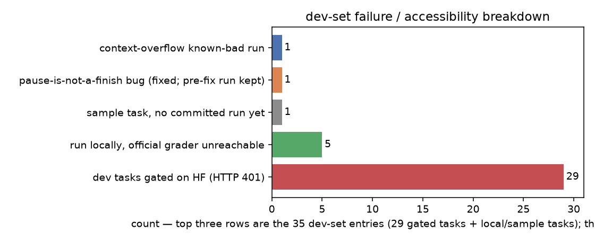

# A minimal harness that gives the model one shell and the task's MCP tools

**Entry:** `bnty-0739-harness-v2` (the true Jan 5 entry built on our `bnty-0709` harness v1) · repo: https://github.com/DSP-AID/dail-bnty-0739 (the current `main` HEAD is the verified commit)
**Model endpoint used for verification:** a locally hosted Qwen3-class
multimodal model (OpenAI-compatible server, native tool calling). The
competition itself pairs harnesses with the eight sponsored `google-cloud/*`
models; our entry ships `model_api: google-cloud/gemini-3.8-flash`, and
`serve.resolve_endpoint` reads the environment exactly as the kit exports it —
`MODEL_NAME`, plus `OPENAI_BASE_URL`/`MODEL_BASE_URL` and the key (see
`docs/models.md`), falling back to the Gemini API's own OpenAI-compatible path
(`<GOOGLE_GEMINI_BASE_URL>/v1beta/openai`) when a pairing exports only the
native base. Swapping endpoints is therefore a config change, not a code
change; `runs/pairing-google-cloud/` is a live run taken through that second
path with an endpoint and key we own.


## 1. What the harness is

The harness itself is three files plus one vendored bridge; around them sit the
evidence (`runs/`, `artifacts/`), the dev-set runner (`eval/`) and the figure
script (`scripts/`):

* **`submission.yaml`** — the kit entry (name, model API, install, serve). It
  validates against the official spec offline; we vendored `spec.py` and
  `models.py` from the kit precisely so that this validation runs in CI with
  no network.
* **`serve.py`** — a WebSocket server on `$PORT` that speaks the official
  serve protocol via `taskbridge.py` (copied verbatim from
  `sample_submissions/custom-openai`, as the organizers instruct). Per task it
  starts one agent loop, and for each MCP server the task declares it
  enumerates that server's tools and exposes them to the model as
  `<server>__<tool>` functions.
* **`agent_core.py`** — the agent loop, deliberately free of any transport or
  protocol so it can be unit-tested with a mock model and a mock exec.

The tool surface is intentionally tiny: **one shell plus the task's own MCP
tools.** `exec(command)` runs `bash -c` in the task workspace; stdout+stderr
and the exit code go back to the model; output longer than 24k chars is cut
around the middle so the head *and* the tail survive — engineering tasks often
end their interesting output at the tail. We rejected browser tools, file
editors, python REPLs and sub-agents for v1: every extra tool is another
schema the model can misuse, and PLE tasks are graded on files the agent must
produce with tools that already exist in a 2-CPU/4-GB container.



The loop stops on a plain-text reply, on the deadline the bridge reports, or
at `MAX_STEPS` — at which point the model gets one forced wrap-up turn so
there is always a final message describing what it completed and what is
missing. Model calls retry on 429/5xx and transport errors (5/15/30 s), fail
fast on other 4xx, and a failing tool call is fed back to the model as text
rather than crashing the run: we would rather spend two steps recovering than
zero score on a transient hiccup.

## 2. What we verified, and how

Everything below is reproducible on a clean machine with **no API keys**: unit
tests use a mock model and a mock exec; the end-to-end stages need only an
OpenAI-compatible endpoint you own.

* **15 offline unit tests** (`python3 -m pytest tests/ -q`) covering: the loop
  step accounting, exec-failure feedback, the step-budget wrap-up, the time
  guard, output head/tail cutting, MCP tool dispatch, and the HTTP chat layer
  against a mock server (retry on 500, fail-fast on 4xx, malformed-JSON
  tolerance). Three of them feed the *kit's own* exported environment for a
  `google-cloud` pairing into `resolve_endpoint` and assert the harness picks
  the OpenAI-compatible URL it is given, and derives
  `<GOOGLE_GEMINI_BASE_URL>/v1beta/openai` — the same suffix the vendored kit
  uses — when only the native base is exported.
* **The official `kit check` public sample stages**, run against our harness
  container with our local model through the kit's egress proxy — all stages
  that ran passed: entry spec, image build, model reachability, websocket
  listen, the HELLO smoke task (`hello.txt` written in 49 s), and the MCP
  stage (`mcp.txt` written via the task's `secret_word` tool in 26 s). The
  committed log is `runs/kit-check.log`.
* **The same sample instructions replayed without Docker** via
  `runner_local.py`, kept as auditable evidence: `runs/hello/` holds the full
  step-by-step trajectory, its metrics and the produced `hello.txt`; the
  long-memo replay (`runs/long-memo/metrics.json` plus its `run.log`) spent
  2,015,301 prompt / 58,270 completion tokens over 50 model round trips, wrote
  the memo as `part1.md` / `part2.md` / `part3.md`, and then ended on a
  content-only message announcing more work — the "pause is not a finish" bug
  below, at full length.
* **The pause fix, verified live:** `runs/hello-nudge/` is the HELLO task after
  the fix — step 1 writes the file, step 2 is a content-only reply (the old bug
  would have stopped there), the harness nudges once, step 3 verifies the file,
  step 4 finishes: 4 round trips, 2,402 / 78 tokens.
* **The `google-cloud` pairing path, verified live:** `runs/pairing-google-cloud/`
  runs the same task with only `GOOGLE_GEMINI_BASE_URL` + `GEMINI_API_KEY` in
  the environment (an endpoint and key we own, served by
  `scripts/gemini_openai_shim.py`, which reproduces the `/v1beta/openai/*` path
  shape and forwards to our model). Four round trips, `hello.txt` = `HELLO`.
* **The dev set, as far as we could reach it:** `eval/dev_set.yaml` pins the 29
  public `split: dev` tasks; `eval/run.py --probe` asks Hugging Face for each
  task's four files and records what comes back. Without a granted token all
  29 answer **401**, which is stored in `artifacts/hf_gate.json`; the same
  script then replays every committed local run into one table,
  `artifacts/dev_results.json` — 35 entries: 5 tasks run locally, 29 gated 401,
  1 sample with no local run yet. We did not invent a single dev-set score.
  Every figure is read straight from those committed files by
  `scripts/make_figures.py`.





The score-vs-cost figure is honest about what a "score" means here: the only
official verdicts we hold are the kit's own smoke and MCP stages, so it plots
each committed local run's token cost against the stage that verifies it. The
29 HF dev tasks carry no point on that plot, because they never ran here.

One honesty note we want on the record: the stage log in `runs/kit-check.log`
was taken while `model_api` still named our own endpoint, which is why it ends
with *"model_api names a model of your own, which runs locally only"*. The
entry now ships `model_api: google-cloud/gemini-3.8-flash`, and the official
spec check on this commit prints
`ok: bnty-0739-harness-v2, google-cloud/gemini-3.8-flash (Gemini 3.8 Flash);
egress none`. Every PASS in the log is genuine; a stage run against the
organizer's paired endpoint is what final entry does.

## 3. What actually broke (failure analysis)

* **Working-directory ambiguity.** The HELLO instruction says "a file named
  hello.txt in the working directory". Run through `runner_local.py` (no
  Docker), the model tried `/app/hello.txt` first — the path `kit check` uses
  — then probed, created, and finally wrote `hello.txt` in the actual exec
  cwd: 5 steps where 1 should do. Inside the kit's container it takes one. The
  fix now in the system prompt is one sentence: *"your exec tool runs with
  cwd = the task workspace; write relative paths there."*
* **MCP was not optional.** v1 launched as exec-only; the kit's own public
  sample set includes an MCP stage. We extended the loop mid-flight with a
  dispatch rule — any function name that is not `exec` routes to the MCP
  client — which cost one extra parameter, one branch, and one test. The
  stage then passed on the first re-run.
* **A pause is not a finish.** The loop ends on any model message that carries
  no tool call — that is the "final message" contract. Both long-memo replays
  tripped on it: the 50-round-trip run stopped right after writing three memo
  parts and announcing its next edit, and the replay after the cwd fix stopped
  after 7 round trips (11,422 prompt / 7,238 completion tokens) with *"let me
  rewrite with explicit dimensional checks"* and the memo unwritten. Both are
  committed (`runs/long-memo/`, and `runs/long-memo-retry/` with its trajectory
  and final message) so the failure is visible rather than hidden. The fix is
  in `agent_core.run_loop`: a content-only reply that arrives *after* at least
  one tool call is treated as a pause — the harness appends one user turn
  asking the model to `exec`-verify every deliverable and keep working if any
  is missing, then accepts the next plain-text reply as final. One nudge per
  run, no nudge before the first tool call (so a "done" on a trivial task costs
  nothing), and it cannot loop because the flag is one-way. The cost is one
  extra round trip on runs that pause; the benefit is that a paused run
  finishes — `runs/hello-nudge/` is that path, live.
* **Gated inputs.** The 29 dev tasks are `split: dev` folders of an auto-gated
  Hugging Face dataset. `eval/run.py --probe` requests each task's
  `task.toml`, `instruction.md`, `release.json` and `eval.yaml` and writes what
  comes back: **29/29 tasks, all four files, HTTP 401** — recorded in
  `artifacts/hf_gate.json`, next to the public dataset card we could read
  without a token (`samples/hf-dataset-readme.md`). So "runs end-to-end on
  public sample tasks" here means the kit's own smoke stages plus their
  verbatim instructions, bundled in `samples/`. The same gate is why
  the three Stage-2 harbor runs did not happen
  on this machine: Harbor drives each task as a Docker container built from
  files it downloads from that dataset, and 401 means there is nothing to
  build. `eval/README.md` states the blocker and the command to run once a
  token is granted (`--mode harbor`, which delegates to the official runner).



The breakdown figure is that table, counted by `scripts/make_figures.py` from
`artifacts/dev_results.json`: five local runs — the HELLO task three times (as
shipped, with the pause fix, and through the `google-cloud` pairing path) plus
the two long-memo replays — 29 gated tasks, and the two known-bad runs flagged
as themselves, not folded into a pass rate. The MCP sample has no local replay;
its evidence is the kit's own MCP stage.

## 4. What we deliberately did not build (yet)

No context compaction, no caching, no parallel sub-agents, no retries-with
re-plan, no self-verification pass. Each of these is a plausible Stage-2 win —
the trajectories in `runs/` are there so the wins can be measured rather than
assumed — but for v1 the priority was a loop that cannot die and cannot lie:
bounded steps, bounded time, always a final message, every number in this
writeup parsed from a committed log (`scripts/make_figures.py` plots straight
from `runs/*/metrics.json`, it cannot print a number we did not run).

## 5. Reproduce it

```bash
python3 -m pytest tests/ -q                     # 15 offline tests, mock model + mock exec
python3 eval/run.py --probe                     # network: re-probes the HF gate (needs no key)
python3 eval/run.py                             # rebuilds artifacts/dev_results.json from runs/
python3 scripts/make_figures.py                 # rebuilds figures/ from artifacts/
python -m kit validate .                        # official spec check, no Docker (run from the kit checkout)
python -m kit check . --model-base-url <url> --env-file env.txt   # official stages
MODEL_NAME=<m> OPENAI_BASE_URL=<u> python runner_local.py samples/hello /tmp/out
```

Apache-2.0, vendored files unmodified and attributed. The full January entry
runs the three harbor runs on the hidden set; this repo is the harness that
will run them, and `eval/README.md` records exactly what stands between this
machine and those runs: the `harbor` package the kit's Harbor agent imports,
and a granted Hugging Face token for
`google/physical-engineerings-last-exam`.
